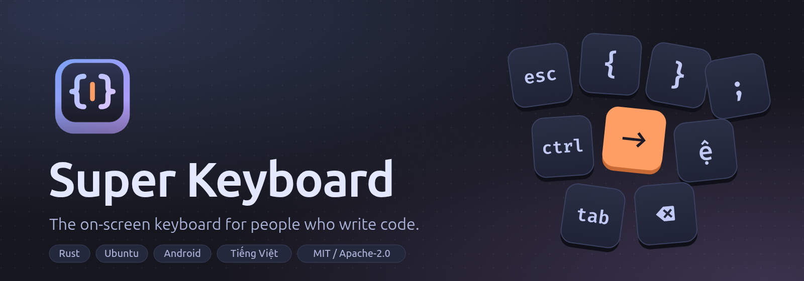
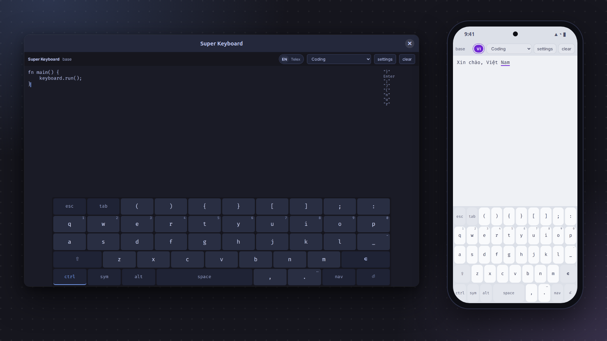
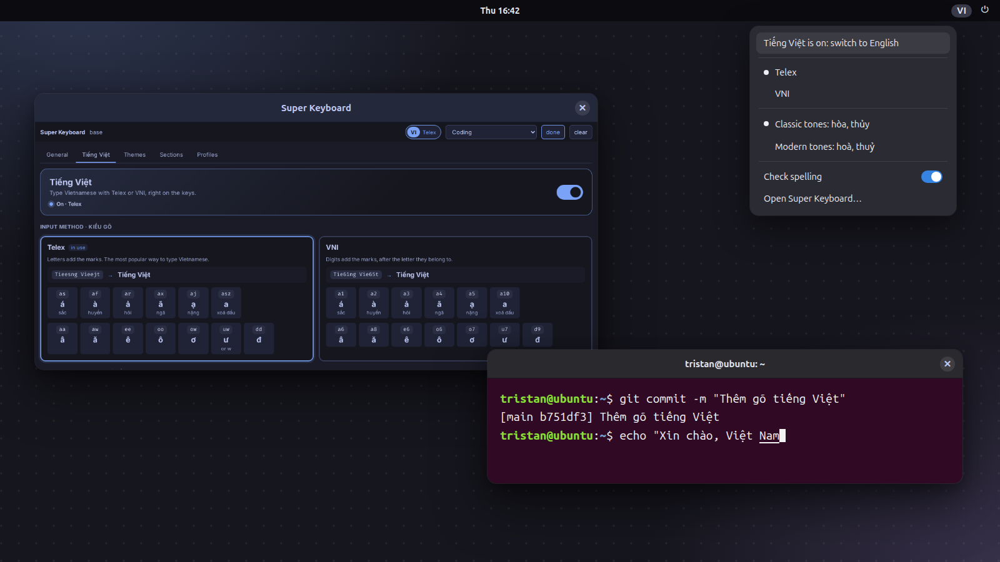
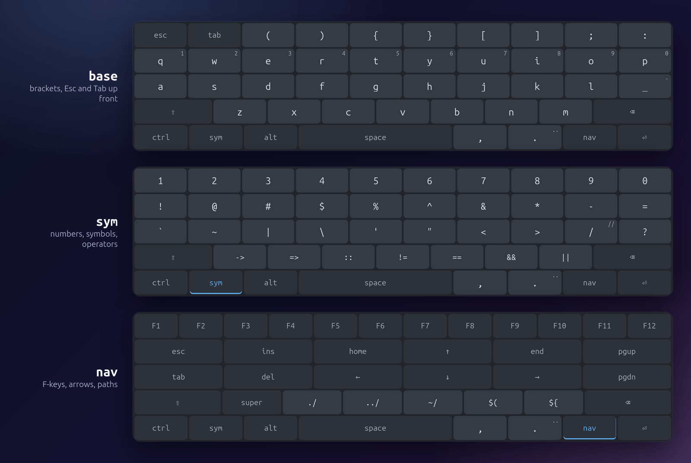
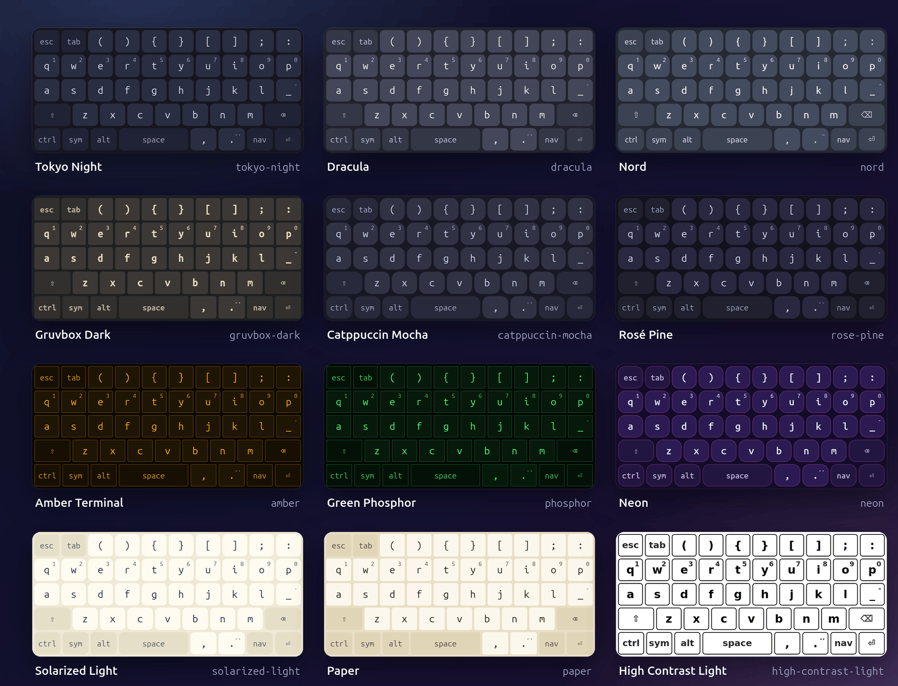
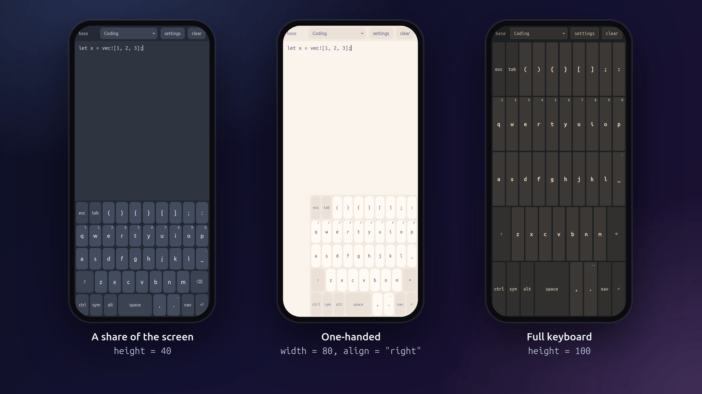
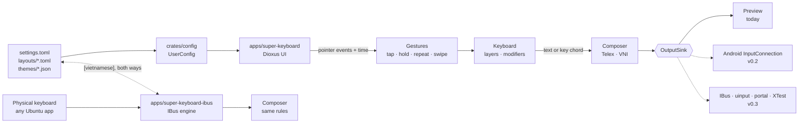
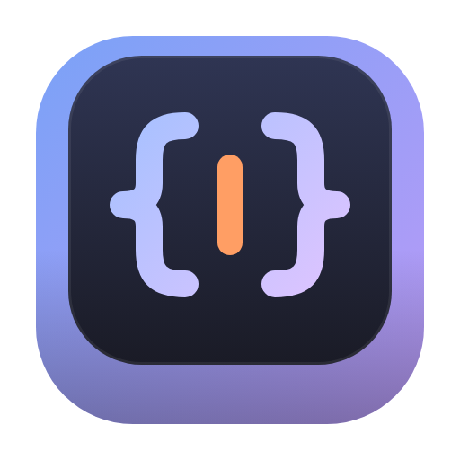

<div align="center">

<picture>
  <source media="(prefers-color-scheme: dark)" srcset="docs/images/banner-dark.png">
  <source media="(prefers-color-scheme: light)" srcset="docs/images/banner-light.png">
  
</picture>

<br>

[](https://github.com/tristanseltec/super-keyboard/actions/workflows/ci.yml)
[](#license)
[](https://www.rust-lang.org)
[](https://dioxuslabs.com)
[](#install)
[](#tiếng-việt)
<br>
[](docs/ROADMAP.md)
[](https://github.com/tristanseltec/super-keyboard/labels/good%20first%20issue)
[](https://github.com/tristanseltec/super-keyboard/discussions)

**Brackets, Esc, Tab, Ctrl and arrows where your thumbs already are.**<br>
Layouts and themes are plain files. Vietnamese is built in. One Rust engine for Android and the Ubuntu desktop.

[Install](#install) ·
[Features](#features) ·
[Tiếng Việt](#tiếng-việt) ·
[Themes](#themes) ·
[Make it yours](#make-it-yours) ·
[Roadmap](#roadmap) ·
[Contributing](#contributing)

<br>



</div>

> [!NOTE]
> **Pre-alpha, and moving fast.** The keyboard is feature-complete for v0.1 and types into
> its own preview; first runs on more Ubuntu machines and Android phones are under way.
> **Vietnamese already types into every app on Ubuntu** with your physical keyboard, through
> the bundled IBus input method. Typing into other apps with the *on-screen* keys comes
> next: the [Android system keyboard](#roadmap) (v0.2), then the [Ubuntu desktop](#roadmap)
> (v0.3). Now is a great time to [get involved](#contributing).

## Why Super Keyboard?

Phone keyboards hide `{` three taps deep and have no Esc, Tab, Ctrl or arrow keys. Desktop
on-screen keyboards are built for accessibility, not for code. Super Keyboard is built for
the moments when a touchscreen is all you have and you still need to write code:

- **SSH from your phone** into a server, a Raspberry Pi or a build box, with `Ctrl+C`,
  `Tab` completion and arrow keys.
- **Edit in Vim, Helix or Emacs on a tablet** with Esc on the base layer and one-tap chords.
- **Drive a terminal on a touchscreen laptop**, or keep a programmable symbol pad beside
  your editor.
- **Write code and Vietnamese side by side**: comments, commit messages and chats in
  *tiếng Việt*, code in English, one switch apart.

<table>
<tr>
<td width="50%" valign="top">

**⌨️ Built for code.** Brackets, Esc and Tab sit on the base layer. Operators like `->`,
`=>`, `::` and `&&` are one key each. Ctrl, Alt, Shift and Super latch, so a tap on
`ctrl` and then `c` sends `Ctrl+C`.

</td>
<td width="50%" valign="top">

**🇻🇳 Tiếng Việt built in.** Telex or VNI on the on-screen keys, and on your physical
keyboard in every Ubuntu app. One switch, one set of settings, in sync both ways. Most code
and English type as written.

</td>
</tr>
<tr>
<td width="50%" valign="top">

**🧩 Layouts as code.** Keyboards are TOML files made of named sections. Profiles switch
sections on or off and reorder them. Mistakes are reported with the file, row and key,
and never break the keyboard.

</td>
<td width="50%" valign="top">

**🎨 24 themes, or your own.** Each theme has its own colours and fonts, and is a short
JSON file you can copy and change. Follow the system with one light and one dark theme.

</td>
</tr>
<tr>
<td width="50%" valign="top">

**🦀 One engine, tested to the bone.** All typing rules live in one Rust crate with no UI
or platform code: 200+ tests, property tests, and end-to-end tests through a real IBus.

</td>
<td width="50%" valign="top">

**🔒 Private by design.** No network access, no telemetry and no logging of typed text.
Layouts and themes are data that can never run code or load anything.

</td>
</tr>
</table>

## Features

| | Feature | Status |
|---|---|---|
| **Typing** | Developer layout: brackets, Esc and Tab on the base layer; symbols, operators, navigation and F-keys one tap away | ✅ Done |
| | One-shot and locked modifiers: tap `ctrl` then `c` for `Ctrl+C`; tap twice to lock | ✅ Done |
| | Long-press actions, key repeat for Backspace and arrows, space-bar cursor swipe (Shift selects) | ✅ Done |
| **Tiếng Việt** | Telex and VNI on the on-screen keys, with a VI / EN switch and live cheat sheets | ✅ Done |
| | Vietnamese with the physical keyboard in every Ubuntu app (IBus), in sync with the app | ✅ Done |
| | Shorthand (*gõ tắt*), English auto-restore, per-app VI / EN, VIQR | 🗺️ v0.5 |
| **Make it yours** | Layouts in TOML ("keyboard as code") with clear, located errors | ✅ Done |
| | Modular sections (number row, brackets, terminal keys...) switched on or off and reordered per profile | ✅ Done |
| | Profiles and presets (Coding, Terminal, Compact...) and a profile menu you can reorder and trim | ✅ Done |
| | 24 themes with their own colours and fonts; your own themes as JSON | ✅ Done |
| | Keyboard width, height and position as a share of the window, up to a full-window keyboard | ✅ Done |
| | Settings screen, and a `settings.toml` that keeps your comments; files reload live on the desktop | ✅ Done |
| **Platforms** | Dioxus app for Ubuntu desktop and Android, with an in-app preview; `.deb` and AppImage | 🧪 Desktop app tested in CI; first runs on real machines and Android devices in progress |
| | Android system keyboard (IME) that types into any app, including Ctrl/Alt chords in Termux | 🔜 v0.2 |
| | Ubuntu desktop keyboard that types into other windows (IBus, uinput, portal, XTest) | 🔜 v0.3 |
| **Power features** | Snippets per language, auto-pairs, macros, per-app profiles, opt-in clipboard history | 🗺️ v0.4 |
| | Use your phone as a dev keypad for your desktop | 🗺️ Later |

## Tiếng Việt



Super Keyboard types Vietnamese the two ways Vietnamese typists already know. Turn it on
with the **VI** button in the top bar, and pick the method on the **Tiếng Việt** settings
tab, whose cheat sheets are typed by the engine itself:

| | Telex | VNI | Result |
|---|---|---|---|
| Tones | `s` `f` `r` `x` `j` | `1` `2` `3` `4` `5` | sắc á · huyền à · hỏi ả · ngã ã · nặng ạ |
| Remove the tone | `z` | `0` | a |
| Letters | `aa` `aw` `ee` `oo` `ow` `uw` `dd` | `a6` `a8` `e6` `o6` `o7` `u7` `d9` | â ă ê ô ơ ư đ |
| Example | `Tieesng Vieejt` | `Tie61ng Vie65t` | **Tiếng Việt** |

- **Type naturally.** Marks can go anywhere in the word (`tiengse` is *tiếng*), and the
  tone moves to the right vowel as the word grows (`hòa` + `n` is *hoàn*).
- **Change your mind.** Press a mark's key twice to take it off (`ass` is *as*), and
  Backspace edits the word while it is underlined.
- **Code stays code.** With the spelling check on, only words that can be Vietnamese
  change, so `for`, `class` and `print` type as written.
- **Your style.** Classic (*hòa, thủy*) or modern (*hoà, thuỷ*) tone placement.

**On your physical keyboard, in every app.** The `.deb` installs **Vietnamese (Super
Keyboard)**, an IBus input method that uses the same rules and the same settings. Pick it
with <kbd>Super</kbd>+<kbd>Space</kbd> and type Vietnamese in your terminal, browser and
editor. GNOME's top bar shows **VI** or **EN** with a menu for the method and tones;
change them there or in the app, and the other follows within a second. See
[the guide](docs/CUSTOMIZING.md#vietnamese-typing).

## The `dev` layout

Three layers, one tap apart. Every layer keeps the same bottom row, so `ctrl`, `sym`,
`nav` and Enter never move.

 and &&; nav with F1 to F12, arrows, Home, End and shell paths">

- **Hold** `q` to `p` for `1` to `0`, `.` for `..`, `_` for `-` and `/` for `//`. Hold actions
  show as small hints on the key.
- **Swipe** along the space bar to move the cursor; with Shift on, the swipe selects.
- **Latch** a modifier: tap once for the next key, twice to lock, three times to release.
- **Switch** layers with `sym` and `nav`; tap again, or the layer name in the top bar, to go
  back.

<details>
<summary>The same layout as text</summary>

```text
 base                                         sym                               nav
 esc tab  (   )   {   }   [   ]   ;   :       1  2  3  4  5  6  7  8  9  0      F1 … F12
  q   w   e   r   t   y   u   i   o   p       !  @  #  $  %  ^  &  *  -  =      esc ins home  ↑  end pgup
  a   s   d   f   g   h   j   k   l   _       `  ~  |  \  '  "  <  >  /  ?      tab del   ←   ↓   →  pgdn
  ⇧    z   x   c   v   b   n   m     ⌫        ⇧  -> => :: != == && ||   ⌫       ⇧ super ./ ../ ~/ $( ${ ⌫
 ctrl sym alt [   space   ]  ,   .  nav ⏎     (same bottom row on every layer)
```

</details>

## Themes



Pick a theme on the settings screen's **Themes** tab, where every theme is drawn in its own
colours and fonts. You can follow the system's light and dark mode with one theme for each,
or keep one theme all the time.

| Dark | Light |
|---|---|
| `dark` · `tokyo-night` · `dracula` · `nord` · `gruvbox-dark` · `solarized-dark` · `catppuccin-mocha` · `one-dark` · `rose-pine` · `everforest-dark` · `kanagawa` · `aubergine` · `oled` · `amber` · `phosphor` · `neon` · `high-contrast-dark` | `light` · `solarized-light` · `gruvbox-light` · `catppuccin-latte` · `rose-pine-dawn` · `paper` · `high-contrast-light` |

Every built-in theme keeps key labels at 7:1 contrast or better, and a test checks every
theme. A theme is a short JSON file. Put yours in `~/.config/super-keyboard/themes/`, or
on the desktop press **edit a copy** to start from the theme you use. Anything you leave out comes from
the built-in theme with the same appearance:

```json
{
  "title": "Midnight",
  "appearance": "dark",
  "colors": { "bg": "#0b1020", "key": "#1b2340", "accent": "#ffb454" },
  "fonts": {
    "ui":   { "family": ["Inter", "sans-serif"] },
    "keys": { "family": ["Fira Code", "monospace"], "weight": 500 }
  },
  "sizes": { "radius": "10px" }
}
```

Fonts are looked up among the ones you have installed and are never downloaded. The whole
format, every colour and an editor schema are in [docs/CUSTOMIZING.md](docs/CUSTOMIZING.md#themes).

## Any size you need



Give the keyboard a share of the window, make it narrower and move it to one side for
one-handed typing, or let it fill the window and grow and shrink with it. Labels scale
with the keys. Set it on the **General** tab or in `settings.toml`:

```toml
[keyboard]
height = 45        # percent of the window; 100 fills it, "auto" fits the keys
width = 80         # percent of the window; "auto" is the full width
align = "right"    # "center", "left" or "right"
```

## Make it yours

Everything lives in one folder, `~/.config/super-keyboard/` on Linux. Nothing has to exist
until you change something, and on the desktop the app reloads files as you save them:

```text
~/.config/super-keyboard/
├── settings.toml     profile, theme, key timing, keyboard size, style
├── layouts/*.toml    your layouts; dev.toml replaces the built-in one
└── themes/*.json     your themes; nord.json replaces the built-in Nord
```

**Layouts are TOML.** This is all it takes to define a layer:

```toml
[[layers]]
name = "base"
rows = [
    ["<esc>", "<tab>", "(", ")", "{", "}", "[", "]", ";", ":"],
    [{ tap = "q", hold = "1" }, "w", "e", "r", "t", "y", "u", "i", "o", "p"],
    ["<ctrl>", "<layer:sym>", { tap = "<space>", width = 3.0, swipe = "cursor" }, "->", "<enter>"],
]
```

`"->"` inserts text, `"<esc>"` presses a key, `"<ctrl>"` arms a modifier and `"<layer:sym>"`
switches layer; `hold`, `swipe`, `width` and `repeat` are options. Real layouts group rows
into named `[[sections]]` that profiles rearrange.

**Profiles arrange sections.** The app ships presets (Coding, Coding with a number row,
Terminal, Compact). Change one and you get your own copy; pick profiles from the top bar.

**Settings are one file.** The settings screen writes it for you and keeps your comments:

```toml
# ~/.config/super-keyboard/settings.toml
profile = "mine"
theme = "system"          # follow the system: light-theme by day, dark-theme by night
dark-theme = "nord"

[keys]
hold-delay = 300          # ms
repeat-rate = 30          # per second

[style.dark]              # tweak any theme variable
accent = "#ff9e64"

[[profiles]]
name = "mine"
layout = "dev"
sections = { number-row = true, brackets = false }
```

A mistake never stops the keyboard. The app shows what is wrong and where, and keeps the
last good version of the file while you fix it:

```text
layouts/vim.toml       layer `base`, row 2, key 4: unknown key `<esc2>`
themes/midnight.json   `colors.acent` is not a theme colour (known: bg, panel, key, ...)
```

📖 **[The customizing guide](docs/CUSTOMIZING.md)** covers every option, key and colour.

## Install

Super Keyboard is pre-alpha, so for now you build it from source; signed packages on
GitHub Releases, a PPA and Flathub are on the [v1.0 roadmap](docs/ROADMAP.md#v10-ready-for-everyone).
You need [Rust](https://rustup.rs) 1.88 or newer.

```sh
git clone https://github.com/tristanseltec/super-keyboard
cd super-keyboard

# Engine, config and UI tests, including property tests. Needs no system libraries.
cargo test --workspace --no-default-features
```

<details open>
<summary><b>🐧 Run on Ubuntu desktop</b></summary>

```sh
# System libraries for the Dioxus desktop webview (Ubuntu 22.04, 24.04 and 26.10)
sudo apt install build-essential pkgconf libwebkit2gtk-4.1-dev libgtk-3-dev \
  libayatana-appindicator3-dev libxdo-dev libssl-dev librsvg2-dev

# The Dioxus CLI, pinned to the Dioxus version this project uses
cargo install dioxus-cli --version 0.7.10 --locked

dx serve -p super-keyboard --desktop
```

> [!TIP]
> Ubuntu's own `dx` package (OpenDX) also installs a `/usr/bin/dx`. Check that
> `dx --version` prints `dioxus 0.7.10`; if not, put `~/.cargo/bin` before `/usr/bin`
> in your `PATH`.

</details>

<details>
<summary><b>📦 Build and install the .deb (app and Vietnamese input method)</b></summary>

```sh
cargo build --release -p super-keyboard-ibus      # the IBus engine the .deb ships
dx bundle -p super-keyboard --desktop --release --package-types deb

sudo apt install ./target/dx/super-keyboard/bundle/linux/deb/super-keyboard_*_amd64.deb
ibus restart
```

Then add **Vietnamese (Super Keyboard)** in **Settings → Keyboard → Input Sources**. Only
want the input method? `apps/super-keyboard-ibus/install.sh` builds and installs just that,
and adds the input source for you.

</details>

<details>
<summary><b>🤖 Run on Android</b></summary>

Install Android Studio (or the command-line tools) with an SDK, the NDK and a JDK 17, and
connect a device with USB debugging on, or start an emulator.

```sh
rustup target add aarch64-linux-android armv7-linux-androideabi x86_64-linux-android
export ANDROID_HOME="$HOME/Android/Sdk"
export ANDROID_NDK_HOME="$ANDROID_HOME/ndk/<version>"
export JAVA_HOME="<path to JDK 17>"   # Android Studio ships one in android-studio/jbr

dx serve -p super-keyboard --android
```

For now this runs Super Keyboard as an app. Running it as the system keyboard is
[v0.2](docs/ROADMAP.md#v02-android-system-keyboard).

</details>

## How it works



The engine (`crates/core`) has no UI or platform code, so it runs and is tested on any
machine and is shared by every front end. Gesture timing lives in the engine with the clock
passed in, so long-press and repeat behave the same everywhere. The engine only ever emits
two things, text such as `"->"` and key chords such as `Ctrl+Shift+T`, and each platform
implements one small trait to deliver them. Vietnamese is a `Composer` between the two
that rewrites what is on screen with Backspace and text, so it works with every sink; the
IBus engine runs the same composer on physical keys and shows the word as pre-edit text.
The hard parts, hosting the UI in an Android IME and typing into other windows on GNOME
Wayland, are written up with their options in [docs/ARCHITECTURE.md](docs/ARCHITECTURE.md).

| Path | What it is |
|---|---|
| [`crates/core`](crates/core) | The engine: layouts, actions, gestures, the keyboard state machine, Vietnamese, output sinks |
| [`crates/config`](crates/config) | Settings, layouts, themes and profiles from the config directory, with live reload |
| [`crates/config/themes`](crates/config/themes) | The built-in themes and their JSON schema |
| [`apps/super-keyboard`](apps/super-keyboard) | The Dioxus app for Ubuntu desktop and Android |
| [`apps/super-keyboard-ibus`](apps/super-keyboard-ibus) | The Vietnamese input method for IBus, with its end-to-end tests |
| [`docs`](docs) | [Architecture](docs/ARCHITECTURE.md), [customizing](docs/CUSTOMIZING.md), the [roadmap](docs/ROADMAP.md) and the [brand](docs/BRAND.md) |

## Roadmap

| Milestone | Goal | Status |
|---|---|---|
| **v0.1** MVP keyboard | Type a Rust function and Vim commands in the app, on Ubuntu and Android | 🟢 Features done; device runs open |
| **v0.1** Tiếng Việt | Telex and VNI on screen, and with the physical keyboard in every Ubuntu app | ✅ Done |
| **v0.2** Android system keyboard | Enable it in Android settings; type into any app, Termux chords and Vietnamese included | 🔜 Next |
| **v0.3** Ubuntu desktop keyboard | Type into the focused app on GNOME (Wayland and X11) without taking focus | 🗺️ Planned |
| **v0.4** Power features | Snippets, auto-pairs, macros, per-app profiles, a visual layout editor | 🗺️ Planned |
| **v0.5** Better Vietnamese | Shorthand, English auto-restore, per-app VI / EN, VIQR, a Vietnamese UI | 🗺️ Planned |
| **v1.0** Ready for everyone | Signed packages in the usual stores, stable formats, accessibility and security reviews | 🗺️ Planned |

The [full roadmap](docs/ROADMAP.md) has every item, the principles each one has to keep,
and what is deliberately not planned. Follow along on the
[milestones](https://github.com/tristanseltec/super-keyboard/milestones) page.

## Contributing

Super Keyboard is early, so there is room to shape it, and it is looking for collaborators:

| You are... | Start here |
|---|---|
| 🤖 An **Android** developer (Kotlin, `InputMethodService`, JNI) | [Host the Dioxus UI inside an InputMethodService](https://github.com/tristanseltec/super-keyboard/issues/10) |
| 🐧 A **Linux desktop** developer (Wayland, GNOME, IBus, uinput) | [A keyboard window that never takes focus](https://github.com/tristanseltec/super-keyboard/issues/13), then the IBus sink |
| 🇻🇳 A **Vietnamese** typist or input-method developer | Try the Telex and VNI rules on your own writing and [report a word that types wrong](https://github.com/tristanseltec/super-keyboard/issues/new); shorthand and VIQR are on the [v0.5 list](docs/ROADMAP.md#v05-better-vietnamese) |
| 🦀 A **Rust or Dioxus** developer | [Good first issues](https://github.com/tristanseltec/super-keyboard/labels/good%20first%20issue) such as [auto-pair brackets](https://github.com/tristanseltec/super-keyboard/issues/17) |
| ⌨️ A **keyboard and layout** nerd | Share a layout or a theme in [Discussions](https://github.com/tristanseltec/super-keyboard/discussions) |
| 🎨 A **designer** | The [brand kit](docs/BRAND.md) is open: icons for Android, a docs site, a theme gallery |
| 📱 A **tester** with an Android phone or an Ubuntu machine | [Run it on Ubuntu](https://github.com/tristanseltec/super-keyboard/issues/1) or [on Android](https://github.com/tristanseltec/super-keyboard/issues/2) and tell us what breaks |

The `spike` issues are research: a short write-up of what you tried and measured is a
valuable contribution even without production code. Before a pull request, run:

```sh
cargo fmt --all
cargo clippy --workspace --all-targets --no-default-features
cargo test --workspace --no-default-features
apps/super-keyboard-ibus/tests/e2e.sh      # if you changed Vietnamese typing (needs IBus)
```

Read the [contributing guide](CONTRIBUTING.md) and the [code of conduct](CODE_OF_CONDUCT.md)
to get going.

<a href="https://github.com/tristanseltec/super-keyboard/graphs/contributors">
  
</a>

## Privacy and security

A keyboard sees everything you type, so these rules are not optional:

- **No network.** The keyboard and the input method need no network access, and release
  builds will not request it.
- **No keystroke logging.** Typed text is never written to logs, files or analytics. The
  IBus engine keeps only the word being typed, in memory, and forgets it when the word ends.
- **History is opt-in.** Clipboard and snippet history will be off by default, kept in
  memory, and disabled in password fields.
- **Files are data.** Layouts can insert text and press keys, never run code. Themes and
  styles accept only colours, lengths, font weights and the names of installed fonts, so
  they can never load anything or send what the keyboard shows anywhere.

Found a vulnerability? Please report it privately; see [SECURITY.md](SECURITY.md).

## FAQ

<details>
<summary><b>Can I use it as my phone's keyboard today?</b></summary>
<br>

Not yet. Today it runs as an app on Android and types into its own preview. The system
keyboard (an Android IME) that types into any app is the
[v0.2 milestone](docs/ROADMAP.md#v02-android-system-keyboard), and its
first step is [an open spike](https://github.com/tristanseltec/super-keyboard/issues/10).

</details>

<details>
<summary><b>Can I type Vietnamese in other apps today?</b></summary>
<br>

Yes, on Ubuntu with your physical keyboard: install the `.deb` (or run
`apps/super-keyboard-ibus/install.sh`) and pick **Vietnamese (Super Keyboard)** as an input
source. It works in terminals, browsers and editors, on Wayland and X11. The on-screen keys
type Vietnamese into the app's preview today, and into other apps from v0.3.

</details>

<details>
<summary><b>How is it different from Unikey, ibus-bamboo or ibus-unikey?</b></summary>
<br>

They are great input methods, and the Telex and VNI rules here type the same way. What is
different is that Super Keyboard's input method shares one set of settings with an
on-screen keyboard built for code: switch VI / EN or the method in either place and the
other follows, and the spelling check keeps most code and English as typed. Use whichever you
like; they can be installed side by side.

</details>

<details>
<summary><b>Will it work on Wayland?</b></summary>
<br>

The Vietnamese input method already does, through IBus. For the on-screen keyboard, that is
the goal of v0.3: GNOME on Wayland deliberately stops apps from injecting input or staying
unfocused, so the plan combines a keyboard window that does not take focus with the IBus
engine as a sink (and uinput, xdg-desktop-portal or XTest where needed). The options are
compared in [docs/ARCHITECTURE.md](docs/ARCHITECTURE.md#ubuntu-desktop-typing-into-other-windows).

</details>

<details>
<summary><b>Why Rust and Dioxus?</b></summary>
<br>

One engine, written once and tested anywhere, drives every platform, and Dioxus renders the
same UI on the Ubuntu desktop and on Android. The engine has no UI or platform
dependencies, so `cargo test` checks layouts, gestures, modifiers and Vietnamese in seconds
on any machine, property tests included.

</details>

<details>
<summary><b>Does it support other languages?</b></summary>
<br>

Vietnamese is built in. Beyond that, layouts are just files, so any characters you can put
in TOML can go on a key; layouts for other scripts and keyboard styles are very welcome as
contributions, and more input methods are on the [roadmap](docs/ROADMAP.md).

</details>

<details>
<summary><b>Can I share my layout or theme?</b></summary>
<br>

Please do! Post it in [Discussions](https://github.com/tristanseltec/super-keyboard/discussions)
or open a pull request. Layouts and themes are data, never code, so they are safe to share,
and a community gallery is on the [roadmap](docs/ROADMAP.md#later).

</details>

## Brand



The mark is a keycap with braces and a cursor: a keyboard, for code, while you type. Logos,
icons, banners and colours are in the [brand kit](docs/BRAND.md), as SVG sources and PNGs,
licensed like the code. Writing about Super Keyboard? Use them freely.
<br clear="left">

## Acknowledgements

Super Keyboard is built with [Dioxus](https://dioxuslabs.com), [toml_edit](https://github.com/toml-rs/toml),
[zbus](https://github.com/dbus2/zbus), [IBus](https://github.com/ibus/ibus) and
[proptest](https://github.com/proptest-rs/proptest). The Telex and VNI rules follow the
conventions Vietnamese typists know from Unikey and its successors. The brand uses the
[Ubuntu Sans](https://github.com/canonical/Ubuntu-Sans-fonts) and
[Fira Code](https://github.com/tonsky/FiraCode) fonts. The colour schemes behind several
themes are the work of their authors, all MIT licensed:
[Tokyo Night](https://github.com/enkia/tokyo-night-vscode-theme) by enkia,
[Dracula](https://draculatheme.com), [Nord](https://www.nordtheme.com) by Arctic Ice Studio,
[Gruvbox](https://github.com/morhetz/gruvbox) by morhetz,
[Solarized](https://ethanschoonover.com/solarized/) by Ethan Schoonover,
[Catppuccin](https://catppuccin.com), [One Dark](https://github.com/atom/one-dark-syntax)
from Atom, [Rosé Pine](https://rosepinetheme.com),
[Everforest](https://github.com/sainnhe/everforest) by sainnhe and
[Kanagawa](https://github.com/rebelot/kanagawa.nvim) by rebelot.

## License

Licensed under either of

- Apache License, Version 2.0 ([LICENSE-APACHE](LICENSE-APACHE))
- MIT license ([LICENSE-MIT](LICENSE-MIT))

at your option.

Unless you explicitly state otherwise, any contribution intentionally submitted for
inclusion in the work by you, as defined in the Apache-2.0 license, shall be dual
licensed as above, without any additional terms or conditions.

<div align="center">
<br>

**If Super Keyboard is useful to you, a ⭐ helps others find it.**

</div>
