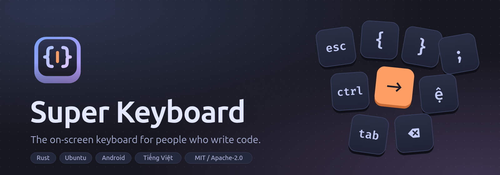
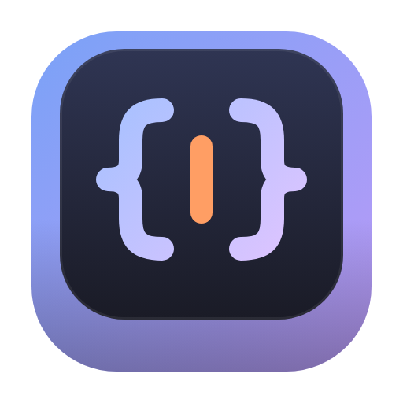

# Super Keyboard brand



Everything here is in [`docs/brand`](brand): hand-written SVG sources, the scripts that
compose and render them, and ready-made PNGs. The artwork is licensed like the code (MIT
OR Apache-2.0); use it to write about, link to, package or build on Super Keyboard.

## The mark



A **keycap** with **braces** on it and a **cursor** between them: a keyboard, for code, while
you type. The blue-to-violet rim is the keycap's edge; the orange cursor is the one warm
note, and the brand's accent colour.

| File | Use it for |
|---|---|
| [`src/logo.svg`](brand/src/logo.svg) | The mark, from 48 px up: app icons, avatars, docs |
| [`src/logo-small.svg`](brand/src/logo-small.svg) | 16 to 32 px: favicons, tray and panel icons |
| [`src/logo-mono.svg`](brand/src/logo-mono.svg) | One colour (`currentColor`): monochrome UIs, print, stickers |
| [`png/lockup-dark.png`](brand/png/lockup-dark.png), [`png/lockup-light.png`](brand/png/lockup-light.png) | Mark and name side by side, for dark or light backgrounds |
| [`png/social-dark.png`](brand/png/social-dark.png) | The GitHub social preview (1280 × 640) and link cards |
| [`../images/banner-dark.png`](images/banner-dark.png), [`banner-light.png`](images/banner-light.png) | The README header |

- **Space:** keep at least a quarter of the mark's width clear around it.
- **Smallest size:** 48 px for `logo.svg`, 16 px for `logo-small.svg`.
- **Don't** recolour the gradient, stretch, rotate or outline the mark, add effects, or put
  the full-colour mark on a busy photo. Use the one-colour mark instead.

## Colour

| Token | Hex | Role |
|---|---|---|
| Blue | `#7aa2f7` | Rim gradient start, links, focus |
| Violet | `#bb9af7` | Rim gradient end |
| Orange | `#ff9e64` | The cursor; one accent per picture, never body text |
| Ink | `#1a1b26` | Keycap face, text on light backgrounds |
| Night | `#16161e` | Dark backgrounds |
| Mist | `#f5f6fb` | Light backgrounds |
| Lavender | `#c0caf5` | Text and key labels on dark backgrounds |
| Slate | `#737aa2` | Secondary text on dark backgrounds |

The palette comes from [Tokyo Night](https://github.com/enkia/tokyo-night-vscode-theme),
the app's default dark theme, so the brand and the product look like each other.

## Type

- **Ubuntu Sans** for the name and headings (weight 750 for the name, tracking −2).
- **Fira Code** for keys, code and anything typed, with ligatures on (`->` is an arrow).

Both are open-source fonts. The PNGs have the text rendered in, so they look the same
everywhere; the SVG sources need the fonts installed to render.

## Voice

Plain, specific and friendly, like a good commit message. Name the key, the file or the
command; show the keystrokes (`Vieejt` → `Việt`); say what does not work yet. Vietnamese
appears in Vietnamese (**Tiếng Việt**), with English beside it where it helps.

Super Keyboard is an independent project. It is not affiliated with Canonical (Ubuntu) or
Google (Android); their names say where it runs.

## Making changes

```sh
# 1. Edit the mark in src/logo*.svg, or the words, colours and layout in compose.py
python3 docs/brand/compose.py      # writes the banners, social cards and lockups in src/

# 2. Render every PNG: app icons, README images, the brand kit
python3 docs/brand/build.py        # needs Chrome or Chromium (set $CHROME if it is not on PATH)
```

The README's hero and Tiếng Việt pictures are real screenshots of the app
([`brand/shots`](brand/shots)), placed in windows by the pages in
[`brand/composites`](brand/composites). [`shots/drive.js`](brand/shots/drive.js) lists how
each shot was taken in the browser preview, so they can be taken again after the UI
changes.
